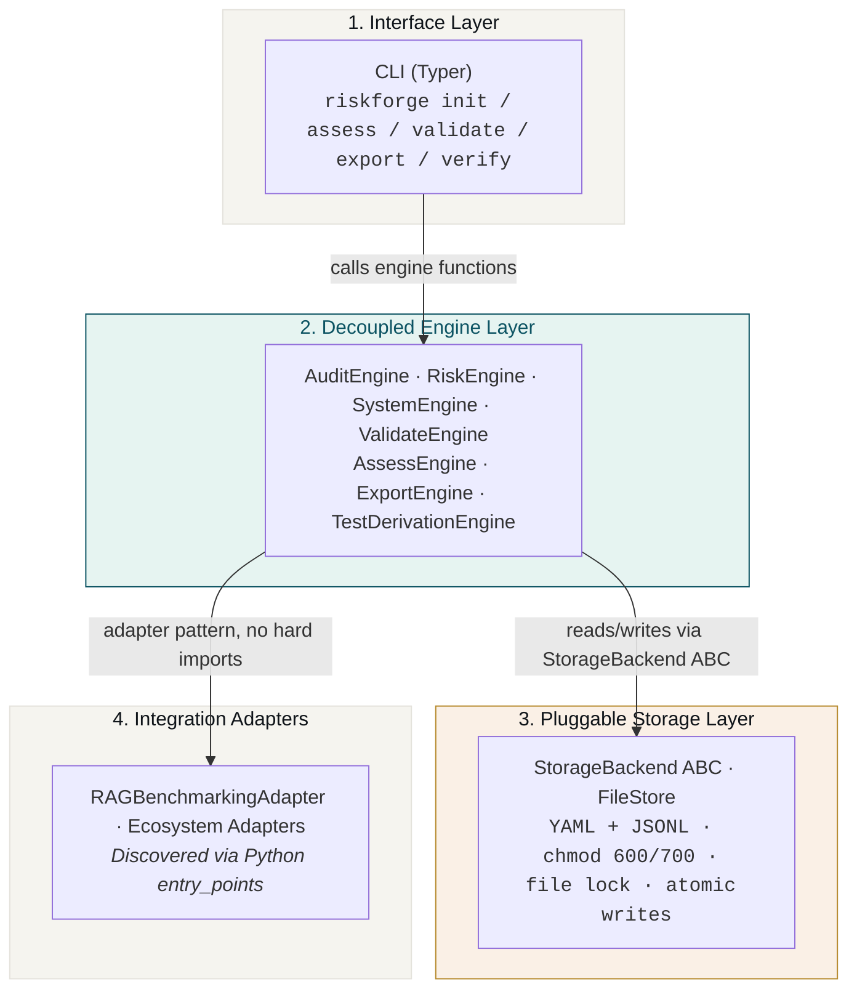
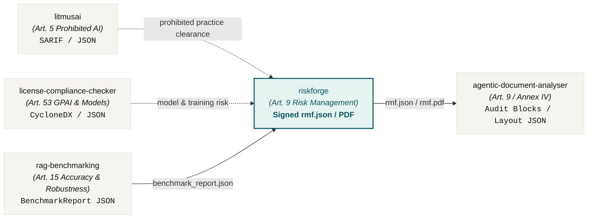
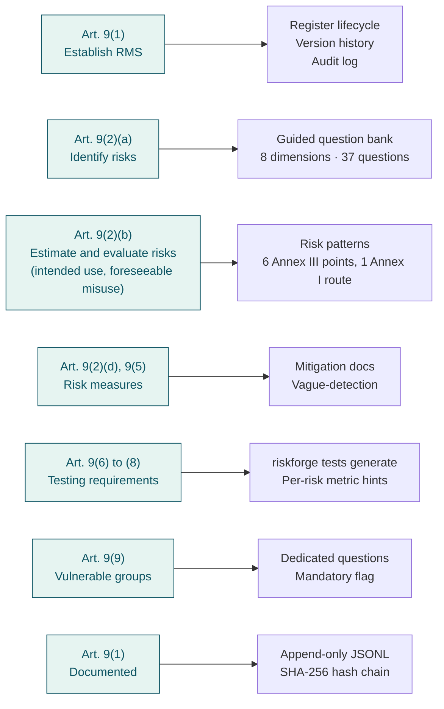

<div align="center">
  <picture>
    <source media="(prefers-color-scheme: dark)" srcset="https://raw.githubusercontent.com/aiexponent/riskforge/main/.github/brand/og-riskforge-dark.png">
    <source media="(prefers-color-scheme: light)" srcset="https://raw.githubusercontent.com/aiexponent/riskforge/main/.github/brand/og-riskforge-light.png">
    
  </picture>
  <h1 align="center">RiskForge</h1>
  <p align="center"><em>EU AI Act Article 9 risk management, as a developer workflow.</em></p>
  <p align="center">
    <a href="https://pypi.org/project/riskforge/"></a>
    <a href="https://github.com/aiexponent/riskforge/actions"></a>
    <a href="LICENSE"></a>
    <a href="https://www.python.org/downloads/"></a>
    <a href="https://eur-lex.europa.eu/legal-content/EN/TXT/?uri=CELEX:32024R1689"></a>
    <a href="#privacy"></a>
  </p>
</div>

---

> **RiskForge produces structured, hash-chained evidence for the EU AI Act Article 9 risk management system and the description of it that Annex IV point 5 asks for. Apache 2.0, provided AS IS.**
>
> RiskForge turns Article 9 risk management into a developer workflow and writes a Risk Management File whose digest, signatures and audit chain anyone can check. It is an engineering tool that produces evidence; it is **not** a notified body, and its output is not a legal certification.

---

## The Problem

Under the EU AI Act ([Regulation (EU) 2024/1689](https://eur-lex.europa.eu/legal-content/EN/TXT/?uri=CELEX:32024R1689)), providers of **high-risk AI systems** (Article 6, Annexes I and III) must establish, implement, document and maintain a continuous **Risk Management System (Article 9)** throughout the entire AI lifecycle.

* **Application Dates**: The high-risk requirements and obligations in Chapter III, Sections 1 to 3 (including Article 9) apply from **2 December 2027** for systems under Article 6(2) and Annex III, and from **2 August 2028** for those under Article 6(1) and Annex I (Article 113, third paragraph, point (c), as amended by [Regulation (EU) 2026/1744](https://eur-lex.europa.eu/eli/reg/2026/1744/oj/eng), in force since 27 July 2026).
* **Penalties**: breaches of the provider obligations can be fined up to **€15,000,000 or, for an undertaking, 3% of its total worldwide annual turnover for the preceding financial year, whichever is higher** (Article 99(4)); for SMEs, including start-ups, and for small mid-cap enterprises, whichever is lower (Article 99(6) and (6a)).
* **The bottleneck**: Article 9(2) makes risk management a continuous iterative process, run throughout the lifecycle with regular systematic review and updating, and advisory engagements are not built for that pace.

**RiskForge** is built around one question, asked in your terminal or CI/CD pipeline:

> *"How do we assess and mitigate Article 9 risks continuously, and keep evidence of it that an auditor can check, without blocking product velocity?"*

Run through a guided, 37-question assessment across **8 risk dimensions**. RiskForge produces a tamper-evident Risk Management File (JSON, PDF, or Markdown) backed by a SHA-256 hash chain, optional Ed25519 signatures, and cross-references to ISO/IEC 42001 and the NIST AI RMF. It runs offline, with zero telemetry.

Built by [AI Exponent LLC](https://aiexponent.com). Apache 2.0. Runs entirely offline after `pip install`.

---

## Quick Start

```bash
pip install riskforge
```

> [!NOTE]
> **PDF export prerequisites:** PDF generation uses WeasyPrint, which requires underlying system graphical libraries (Pango, Cairo, GDK-PixBuf, libffi):
> - **Debian / Ubuntu:** `sudo apt-get install -y libpango-1.0-0 libpangocairo-1.0-0 libcairo2 libgdk-pixbuf-2.0-0 libffi-dev shared-mime-info`
> - **macOS:** `brew install pango cairo gdk-pixbuf libffi`
> - **Windows:** WSL2 (Ubuntu) is recommended with the Debian/Ubuntu packages above. For native Windows, install the GTK3 runtime libraries.
>
> JSON and Markdown export require no additional system libraries beyond `pip install`.

```bash
# 1. Register your AI system (prints the system id that every later command takes)
riskforge init \
  --name "Loan Scoring Model" \
  --sys-version "2.1" \
  --purpose "Automated credit scoring for retail loan applications." \
  --provider "Acme Financial Services" \
  --category essential_services
```

```bash
# 2. Record your Article 6(2) Annex III self-classification (required before export)
riskforge system classify <system-id> --confirm
```

```bash
# 3. Run the guided 8-dimension risk assessment: 37 questions
riskforge assess <system-id> \
  --assessor-name "Alice Chen" \
  --assessor-role "AI Governance Lead"

# For CI or reproducible fixtures, run it from a YAML answers file. Running it again
# updates the items it created and never adds duplicates:
#   riskforge assess <system-id> -a "Alice Chen" -r "AI Governance Lead" --answers answers.yaml
```

```bash
# 4. Record mitigations and accept residual risk (gate G3 fails until every risk whose
#    residual score is above the appetite threshold is re-scored at or below it, or accepted)
riskforge risk list <system-id>
riskforge risk mitigate <system-id> <risk-id> \
  -m "Remove postcode feature; add demographic parity monitoring" \
  -c preventive --owner "ML Platform" --residual-likelihood 2 --residual-severity 3 \
  --by "Dr. Lena Fischer, AI Governance Lead"
riskforge risk accept <system-id> <risk-id> --rationale "Residual within appetite after controls." \
  --by "Dr. Lena Fischer, AI Governance Lead"

# 5. Derive Article 9(6) to (8) test requirements for knowledge-gap risks and risks scoring 9 or more, and save them
#    on the register (the export carries them; gate G4 warns until every knowledge gap has one)
riskforge tests generate <system-id>

# 6. Check completeness before export (exit 1 if a FAIL gate is unmet)
riskforge validate <system-id>
```

```bash
# 7. Create an Ed25519 signing key once, outside the project (keygen never overwrites a file)
mkdir -p ~/.config/riskforge
riskforge keygen --output ~/.config/riskforge/signing.pem

# 8. Export your Article 9 Risk Management File, signing the JSON
riskforge export <system-id> --format json --output rmf.json --sign ~/.config/riskforge/signing.pem
riskforge export <system-id> --format pdf --output rmf.pdf

# 9. Take a receipt and keep it where the project's editors cannot change it
mkdir -p ~/riskforge-receipts
riskforge receipt <system-id> --output ~/riskforge-receipts/loan-scoring.json

# 10. Verify any time (exit 2 if anything was altered)
riskforge verify
riskforge verify --file rmf.json --trusted-key ~/.config/riskforge/signing.pem.pub
riskforge verify --receipt ~/riskforge-receipts/loan-scoring.json
```

<p align="center">
  
</p>

---

## Why RiskForge

| Evaluation Method | Cost | Deterministic / Repeatable? | Offline / Zero-Telemetry? |
| :--- | :--- | :--- | :--- |
| **Big 4 Consulting** | Paid engagement per system | ❌ No (Advisory opinion) | ❌ No (NDAs & data sharing) |
| **Enterprise GRC Platforms** | Annual license | ⚠️ Partial | ⚠️ Depends on the product and deployment |
| **Internal Spreadsheets** | "Free" | ❌ No (Human error) | ⚠️ Manual |
| **RiskForge** | **Free (Apache 2.0)** | **✅ Yes (Deterministic hash)** | **✅ Yes (100% offline, zero network)** |

---

## System Architecture

RiskForge has four layers with CI-enforced import boundaries (ADR-02):



**State on disk:**

```
your-project/
├── riskforge.yaml                     project manifest (chmod 600)
├── .riskforge/                        (chmod 700)
│   ├── audit.jsonl                    append-only hash-chained audit log
│   ├── audit.head.json                sequence number and hash of the last entry
│   ├── audit.lock                     serializes writers across processes
│   ├── txn.json                       exists only while a change is being committed
│   ├── .nodelete                      deletion sentinel
│   └── systems/<system-id>/
│       ├── system.yaml
│       ├── register.yaml
│       └── mitigations.yaml
└── rmf-<id>-<export>.json             exports land where --output says (default: the project directory)
```

Plain YAML plus JSONL: readable by regulators without RiskForge installed, and diff-able in GitHub PRs.

---

## AI Exponent Governance Toolchain

RiskForge is the Article 9 tool in the open-source AI Exponent governance toolchain:



All interactions occur via plain JSON artifacts on disk. RiskForge never calls external cloud APIs.

---

## EU AI Act Article 9 Coverage



Cross-maps to:
* **NIST AI RMF 1.0**: `GOVERN`, `MAP`, `MEASURE`, `MANAGE`
* **ISO/IEC 42001:2023**: Clauses 6.1 and 9.1, and Annex A.6, A.7 and A.9
* **Colorado AI Act**: SB 24-205, repealed and reenacted by SB 26-189 (signed 14 May 2026)
* **Texas Responsible Artificial Intelligence Governance Act**: Texas HB 149 (TRAIGA), in effect since 1 January 2026

---

## Validation Gates

Before every export, `riskforge validate` runs 8 automated gates:

| Gate | Check |
|---|---|
| G1 | All 8 risk dimensions have at least one entry |
| G2 | Article 6(2) Annex III self-classification documented |
| G3 | Every risk whose residual score is above the appetite threshold is re-scored at or below it, or accepted with a rationale |
| G4 | Knowledge gaps have test requirements |
| G5 | System metadata complete |
| G6 | Assessor identity recorded |
| G7 | Risk score distribution plausible (warns if all scores are low) |
| G8 | No vague mitigation language detected |

---

## Interactive Artifact Previews

<details>
  <summary><b>📄 View a starter <code>system.yaml</code></b></summary>

The system record `riskforge init` writes to `.riskforge/systems/<system-id>/system.yaml`,
after `riskforge system classify --confirm`.

```yaml
id: 4a3cbcd1-0841-46e6-af5a-6f37af068f28
name: Loan Scoring Model
version: '2.1'
purpose: Automated credit scoring for retail loan applications.
intended_users: []
inputs: []
outputs: []
deployment_context: ''
annex_iii_category: essential_services
annex_iii_self_classification_documented: true
provider_name: Acme Financial Services
provider_contact: ''
created_at: '2026-10-17T19:30:17.266671Z'
schema_version: 1.0.0
```
</details>

<details>
  <summary><b>🔍 View an exported <code>rmf.json</code> (one risk item, schema 1.1.0, signed)</b></summary>

A complete export from a one-risk project, signed with a throwaway key from `riskforge keygen`
and made with `--force` because a real assessment covers all eight dimensions.
`tests/contract/test_readme_samples.py` checks that it validates against the schema and that
its digest, signature, chain proof and receipt verify.

```json
{
  "id": "ad9c2b0f-9df4-4f9b-9a5f-ab66b564105b",
  "rmf_schema_version": "1.1.0",
  "register": {
    "id": "8f4988c1-8b20-446f-a643-540e88f657fe",
    "system": {
      "id": "4a3cbcd1-0841-46e6-af5a-6f37af068f28",
      "name": "Loan Scoring Model",
      "version": "2.1",
      "purpose": "Automated credit scoring for retail loan applications.",
      "intended_users": [],
      "inputs": [],
      "outputs": [],
      "deployment_context": "",
      "annex_iii_category": "essential_services",
      "annex_iii_self_classification_documented": true,
      "provider_name": "Acme Financial Services",
      "provider_contact": "",
      "created_at": "2026-10-17T19:30:17.266671Z",
      "schema_version": "1.0.0"
    },
    "items": [
      {
        "id": "646bec44-52cb-4507-9f76-9242c70dc5df",
        "dimension": "discrimination",
        "title": "Has the training dataset been audited for representation imbalances across protected characteristics (gender, ethnicity,",
        "description": "Biased training data produces biased outputs. Article 10(2)(f) requires data governance measures to address biases.",
        "source": "question_bank",
        "likelihood": 4,
        "severity": 5,
        "mitigations": [],
        "residual_likelihood": 4,
        "residual_severity": 5,
        "accepted": true,
        "acceptance_rationale": "Residual within appetite after documented controls.",
        "accepted_by": "Alice Chen, AI Governance Lead",
        "identified_at": "2026-10-17T19:30:17.654252Z",
        "article_refs": [
          "Art.10(2)(f)",
          "Art.9(2)(a)"
        ],
        "nist_rmf_refs": [],
        "iso42001_refs": [],
        "nist_rmf_ref": "MEASURE 2.11",
        "iso42001_ref": "Annex A.7",
        "regulatory_status": "settled",
        "knowledge_gap": false,
        "knowledge_gap_reason": "",
        "source_ref": "",
        "tags": [
          "DI-001"
        ],
        "notes": "",
        "risk_score": 20,
        "residual_risk_score": 20,
        "risk_band": "critical",
        "residual_risk_band": "critical"
      }
    ],
    "risk_appetite_threshold": 9,
    "assessor_name": "Alice Chen",
    "assessor_role": "AI Governance Lead",
    "assessment_date": "2026-10-17T19:30:17.635747Z",
    "review_date": "2027-10-12T19:30:17.635747Z",
    "question_bank_version": "1.0.0",
    "schema_version": "1.0.0",
    "test_requirements": [
      {
        "id": "24f39919-bd59-5782-a875-29242c400d29",
        "risk_item_id": "646bec44-52cb-4507-9f76-9242c70dc5df",
        "description": "Validate 'Has the training dataset been audited for representation imbalances across protected characteristics (gender, ethnicity,' via demographic_parity measurement. Target: <= 0.10.",
        "metric_type": "demographic_parity",
        "threshold_range": "<= 0.10",
        "article_ref": "Art.9(8)",
        "nist_rmf_ref": ""
      }
    ]
  },
  "test_requirements": [
    {
      "id": "24f39919-bd59-5782-a875-29242c400d29",
      "risk_item_id": "646bec44-52cb-4507-9f76-9242c70dc5df",
      "description": "Validate 'Has the training dataset been audited for representation imbalances across protected characteristics (gender, ethnicity,' via demographic_parity measurement. Target: <= 0.10.",
      "metric_type": "demographic_parity",
      "threshold_range": "<= 0.10",
      "article_ref": "Art.9(8)",
      "nist_rmf_ref": ""
    }
  ],
  "cross_references": [
    {
      "article_ref": "Art.10(2)(f)",
      "risk_item_ids": [
        "646bec44-52cb-4507-9f76-9242c70dc5df"
      ],
      "nist_rmf_ref": "MEASURE 2.11",
      "iso42001_ref": "Annex A.7"
    },
    {
      "article_ref": "Art.9(2)(a)",
      "risk_item_ids": [
        "646bec44-52cb-4507-9f76-9242c70dc5df"
      ],
      "nist_rmf_ref": "MEASURE 2.11",
      "iso42001_ref": "Annex A.7"
    }
  ],
  "generated_at": "2026-10-17T19:30:18.872052Z",
  "sha256_hash": "36f65e661f59e51abf142ab79f7afa82cd1920a044f98899942fbd702ae310ca",
  "disclosure": "This document was produced using RiskForge v1.1.3, question bank version 1.0.0. It represents the team's documented risk assessment and has not been reviewed by a qualified legal professional. It does not constitute legal advice under the EU AI Act or any other regulation.",
  "signoffs": [],
  "signatures": [
    {
      "key_id": "ed25519:2b84dc1c4fc5f4fa",
      "algorithm": "ed25519",
      "signed_at": "2026-10-17T19:30:18.872619Z",
      "signature": "4bZFhX3M2hSzWdbZhZKfYAgUPNGzl64aGOsgxa1tdw9eoGjgSLA+HR2K8bw3clVoyrN0+6hkih0yvzyl/BZ3Ag=="
    }
  ],
  "public_keys": [
    {
      "key_id": "ed25519:2b84dc1c4fc5f4fa",
      "algorithm": "ed25519",
      "public_key": "WWXlvEYFbahA6M6po4k0r82iFviXf5u8K3xr3uPL1XM="
    }
  ],
  "chain_proof": {
    "scope": "project",
    "entries": [
      {
        "seq": 0,
        "event": "system.created",
        "timestamp": "2026-10-17T19:30:17.279763Z",
        "actor": {
          "type": "human",
          "identity": "cli"
        },
        "system_id": "4a3cbcd1-0841-46e6-af5a-6f37af068f28",
        "payload": {
          "name": "Loan Scoring Model",
          "version": "2.1",
          "annex_iii_category": "essential_services"
        },
        "prev_hash": "0000000000",
        "entry_hash": "e294b375ba95214d3ad27ec29282e3f857ffd6da03114a1c4fd09b14d16891c7"
      },
      {
        "seq": 1,
        "event": "system.classified",
        "timestamp": "2026-10-17T19:30:17.459261Z",
        "actor": {
          "type": "human",
          "identity": "cli"
        },
        "system_id": "4a3cbcd1-0841-46e6-af5a-6f37af068f28",
        "payload": {
          "annex_iii_self_classification_documented": true,
          "annex_iii_category": "essential_services"
        },
        "prev_hash": "e294b375ba95214d3ad27ec29282e3f857ffd6da03114a1c4fd09b14d16891c7",
        "entry_hash": "6d570849dd72ea48f31bfadeea5731ab7e41b9a1ee16ea0b490537b38b74c455"
      },
      {
        "seq": 2,
        "event": "register.created",
        "timestamp": "2026-10-17T19:30:17.637722Z",
        "actor": {
          "type": "human",
          "identity": "Alice Chen"
        },
        "system_id": "4a3cbcd1-0841-46e6-af5a-6f37af068f28",
        "payload": {
          "assessor_name": "Alice Chen",
          "assessor_role": "AI Governance Lead",
          "review_date": "2027-10-12T19:30:17.635747+00:00"
        },
        "prev_hash": "6d570849dd72ea48f31bfadeea5731ab7e41b9a1ee16ea0b490537b38b74c455",
        "entry_hash": "dace235b86b74233ca24f74457c06c818f3738cb24fa491774e491e0f5de18dd",
        "register_fingerprint": "cf706596118325fbff4f8a84849a0cb332254f47a4586a14a03785dfd47fc903"
      },
      {
        "seq": 3,
        "event": "risk_item.created",
        "timestamp": "2026-10-17T19:30:17.657422Z",
        "actor": {
          "type": "human",
          "identity": "Alice Chen"
        },
        "system_id": "4a3cbcd1-0841-46e6-af5a-6f37af068f28",
        "payload": {
          "risk_item_id": "646bec44-52cb-4507-9f76-9242c70dc5df",
          "dimension": "discrimination",
          "score": 20
        },
        "prev_hash": "dace235b86b74233ca24f74457c06c818f3738cb24fa491774e491e0f5de18dd",
        "entry_hash": "f65a8985ec347bc4be35d958383f63c7d885d4188b732e7868d140d36c9b12cf",
        "register_fingerprint": "20f4bc3c6893249b0c34d9e6c157ac1552a83deb24d239001423f2871025aa89"
      },
      {
        "seq": 4,
        "event": "risk.accepted",
        "timestamp": "2026-10-17T19:30:17.865541Z",
        "actor": {
          "type": "human",
          "identity": "Alice Chen, AI Governance Lead"
        },
        "system_id": "4a3cbcd1-0841-46e6-af5a-6f37af068f28",
        "payload": {
          "risk_item_id": "646bec44-52cb-4507-9f76-9242c70dc5df",
          "old_accepted": false,
          "rationale_hash": "72e990650636afae",
          "actor": "Alice Chen, AI Governance Lead"
        },
        "prev_hash": "f65a8985ec347bc4be35d958383f63c7d885d4188b732e7868d140d36c9b12cf",
        "entry_hash": "0a5557f8fdc94205ff97175daec77e14669731e05f9ec82b2e13cf61b522825b",
        "register_fingerprint": "8229a60ffb696fcc49a54b65530116fa3ad40cf1932ff3f3aafdfad89caee02e"
      },
      {
        "seq": 5,
        "event": "tests.generated",
        "timestamp": "2026-10-17T19:30:18.046335Z",
        "actor": {
          "type": "human",
          "identity": "cli"
        },
        "system_id": "4a3cbcd1-0841-46e6-af5a-6f37af068f28",
        "payload": {
          "count": 1,
          "risk_item_ids": [
            "646bec44-52cb-4507-9f76-9242c70dc5df"
          ]
        },
        "prev_hash": "0a5557f8fdc94205ff97175daec77e14669731e05f9ec82b2e13cf61b522825b",
        "entry_hash": "8ba3456eb9dd956e47db3a3376b3b231badfe83d29819d335e78265d10214553",
        "register_fingerprint": "d3a2a7fecdf633cf3e83526122f8393a98a783b343ad356236f80c0be5e70db6"
      }
    ]
  },
  "receipt": {
    "receipt_version": "1",
    "system_id": "4a3cbcd1-0841-46e6-af5a-6f37af068f28",
    "seq": 5,
    "entry_hash": "8ba3456eb9dd956e47db3a3376b3b231badfe83d29819d335e78265d10214553",
    "register_fingerprint": "d3a2a7fecdf633cf3e83526122f8393a98a783b343ad356236f80c0be5e70db6",
    "issued_at": "2026-10-17T19:30:18.872362Z",
    "key_id": "ed25519:2b84dc1c4fc5f4fa",
    "public_key": "WWXlvEYFbahA6M6po4k0r82iFviXf5u8K3xr3uPL1XM=",
    "signature": "TuOxVMizjt0inM+8fD0NRHPEgxJ0OqlWTdFC+Ib1mPNbNlbxk/KsjxaCn6cqAWsyn0GyzKzmozpdOBbSfpecCg=="
  }
}
```
</details>

---

## CI/CD Integration & Exit Codes

Add RiskForge to your GitHub Actions pipeline as an automated completeness and integrity check:

```yaml
# .github/workflows/article9-gate.yml
name: EU AI Act Article 9 register checks
on: [pull_request, push]

jobs:
  rmf-gate:
    runs-on: ubuntu-latest
    steps:
      - uses: actions/checkout@v6
      - uses: actions/setup-python@v6
        with:
          python-version: "3.11"
      - name: Install RiskForge
        run: pip install riskforge
      - name: Validate Article 9 Gates
        run: riskforge validate <system-id>
      - name: Verify Audit Chain Integrity
        run: riskforge verify --strict
```

This job checks a project committed to the repository. The files in `.riskforge/` hold
your risk assessment, so do this only in a private repository, and never in a public one.

### Exit Code Contract

RiskForge implements deterministic UNIX exit codes for automated CI/CD gating:

| Exit Code | Meaning | CI Behavior |
| :--- | :--- | :--- |
| `0` | **PASS / VALID** | Success: the command succeeded, or what it checked is intact. |
| `1` | **GATE FAILURE** | One or more validation gates failed (unmitigated high risks, missing assessor, unclassified system). Also exits 1: `verify` or `validate` finding a change in progress or unfinished, a command that waited more than 120 seconds for another `riskforge` process to release the project, and an unexpected crash (prints a traceback). |
| `2` | **TAMPER DETECTED** | Integrity failure: the audit chain is corrupt or tampered, a register or system file was changed outside RiskForge, the log was deleted or cut off, or an exported RMF file fails `verify --file` (its digest, a signature, its chain proof or its receipt). `verify` exits 2 (with `--strict`, also on any integrity warning), and every command that changes or exports data exits 2 on such a project without changing it. |
| `3` | **USAGE / INPUT ERROR** | Usage or input error: unknown option or command, missing required option, bad option value, missing or malformed input file, unknown system or risk ID, no project in the directory, no risk register yet, project already exists, `system classify` without `--confirm`, an `export --sign` or `--public-key` value that is not a usable Ed25519 key file, an export output directory that is missing or cannot be written, `verify --strict` with `--file`, a receipt file that is not a receipt, a `--trusted-key` file that is not an Ed25519 public key, a `keygen` or `receipt --output` file that already exists, or interactive `assess` without a terminal. Prints one line saying what to do. |

---

## CLI Command Reference

| Command | Description |
| :--- | :--- |
| `riskforge init` | Create a project and register the AI system; prints the system id. |
| `riskforge system show <id>` | Print the system record. |
| `riskforge system classify <id>` | Document and confirm Article 6(2) Annex III self-classification. |
| `riskforge assess <id>` | Run the interactive 8-dimension guided assessment (supports `--answers`). |
| `riskforge risk mitigate <id> <risk-id> --by NAME` | Document preventive/corrective mitigation controls and re-score residual risk. `--by` (or `RISKFORGE_ACTOR`) names who recorded it; the name is self-declared and not verified. |
| `riskforge risk accept <id> <risk-id> --by NAME` | Formally accept residual risk with documented business/technical rationale. `--by` (or `RISKFORGE_ACTOR`) names who accepted it; the name is self-declared and not verified. |
| `riskforge tests generate <id>` | Generate Article 9(6) to (8) testing requirements for knowledge-gap risks and risks whose inherent score is 9 or more, and save them on the register (exported with the RMF). |
| `riskforge validate <id>` | Execute the 8 completeness and quality gates before report generation. |
| `riskforge export <id>` | Export the Risk Management File to `pdf`, `json`, or `markdown`; `--sign KEY` signs it with an Ed25519 key. |
| `riskforge verify` | Check the project (audit chain, head file, register fingerprints, system files); `--strict` also fails on warnings. |
| `riskforge verify --file rmf.json` | Check one exported file: schema, digest, signatures, sign-offs, chain proof and receipt; `--trusted-key KEY.pub` pins the signer. |
| `riskforge verify --receipt FILE` | Also check that the audit log still holds the entry a receipt names. |
| `riskforge keygen --output KEY` | Create an Ed25519 key pair: `KEY` (mode 600 on Linux and macOS, not encrypted) and `KEY.pub`. |
| `riskforge receipt <id>` | Print or save (`--output FILE`) a receipt for the last audit entry, to keep outside the project. |
| `riskforge diff <id> OLD.json NEW.json` | Show risk items added, removed, and changed between two exports. |
| `riskforge import <id> -a ADAPTER -r REPORT` | Import findings from a rag-benchmarking or TraceForge report. |
| `riskforge risk list <id>` | List the risk items with their scores, bands and acceptance. |
| `riskforge --version` | Print the version, licence and telemetry status. |

---

## Features

| Feature | Detail |
|---|---|
| **Offline-first** | Zero outbound calls after `pip install`, enforced by `pytest-socket` CI gate |
| **Hash-chained audit** | Every change and its audit entry are committed together under a file lock, with a fingerprint of the register; `riskforge verify` exits 2 when the chain, a register or a file was altered |
| **Signed exports and receipts** | Ed25519 keys from `riskforge keygen`; `verify --file` checks the digest, signatures and chain proof; a receipt kept outside the project catches a rewritten chain |
| **Schema-validated exports** | Every export is validated against the bundled RMF schema 1.1.0 (`$id` `https://aiexponent.com/schemas/riskforge/rmf/1.1.0.json`) before it is written |
| **PDF export** | WeasyPrint + Jinja2, no LibreOffice or `wkhtmltopdf` required |
| **Pattern matching** | 7 pre-built risk patterns, each tied to its high-risk route. Six name the Annex III point they cover: credit scoring (5(b)), recruitment and CV screening (4(a)), remote biometric identification (1(a)), assessment of learning outcomes (3(b)), asylum, visa and residence applications (7(c)), and offending risk assessment (6(d)). One covers medical diagnosis and clinical decision support, high-risk under Art. 6(1) where the AI system is, or is a safety component of, a medical device covered by Annex I that must undergo a third-party conformity assessment |
| **Plugin extensible** | Add question banks, exporters, adapters via `pip install`, no config edit required |
| **Git-friendly state** | YAML + JSONL files, human-readable and diff-able. One writer at a time: merging two branches' audit logs breaks the chain, and `verify` reports it |

---

## Contributing

**The easiest contribution requires zero Python**: edit a YAML file and open a PR.

**Add a question** to an existing dimension:

```yaml
# src/riskforge/_data/question_bank/privacy.yaml
- id: PRIV-007
  text: "Does the system process special category data under GDPR Article 9?"
  guidance: "Special category data includes data revealing racial or ethnic origin or political opinions, health data, and biometric data processed to uniquely identify a person (GDPR Article 9(1))."
  annex_iii_categories: [essential_services, employment]
  default_likelihood_hint: 3
  default_severity_hint: 5
  article_refs: ["Art.9(2)(a)", "Art.4a(1)"]
  nist_rmf_ref: "MEASURE 2.10"
  iso42001_ref: "Annex A.7"
  regulatory_status: settled
```

**Add a risk pattern**: edit `src/riskforge/_data/patterns/patterns.yaml`.

**Fix a bug or add a feature**: see [CONTRIBUTING.md](CONTRIBUTING.md).

```bash
git clone https://github.com/aiexponent/riskforge
cd riskforge
make dev-setup   # pip install -e ".[dev]" + pre-commit install
make test        # the full suite; all tests must pass
make lint        # ruff check + format
```

---

## Documentation

- [User Guide](docs/user-guide.md): the CLI workflow, answers files, signing, receipts, CI use, and mitigations.
- [Article 9 Mapping](docs/article-9-mapping.md): what RiskForge does and does not do for each part of Article 9, and how the question bank lines up with it.
- [Audit Chain Design](docs/audit-chain-design.md): the hash chain, register fingerprints, signatures, receipts, and their limits.
- [Architecture Decision Records (ADRs)](docs/adr/): design principles, boundaries, and technical decisions.
- [Contributing Guide](CONTRIBUTING.md): how to contribute questions, patterns, and code.

---

## Important Disclaimers

<a name="evidence-status"></a>

### Technical Documentation & Legal Status

> **REGULATORY EVIDENCE GENERATOR, NOT A NOTIFIED BODY**
>
> RiskForge produces documented evidence and audit logs for the EU AI Act Article 9 risk management system, and the description of that system that Annex IV point 5 asks for. It is a technical workflow tool for engineering and governance teams. A complete RiskForge file shows that the risk management steps were documented; it does not show that the AI system complies with Article 9 or any other provision.
>
> **RiskForge does not constitute legal advice and is not a notified body.** Using RiskForge does not replace mandatory third-party conformity assessment where required under Article 43 of the EU AI Act.

---

## Privacy & Zero-Network Guarantee

<a name="privacy"></a>

RiskForge makes **zero outbound network connections** in CLI mode. Your risk registers, architecture descriptions, mitigation plans, and audit logs remain strictly on your local machine.

```
RiskForge v1.1.3 | Apache 2.0 | Zero telemetry | aiexponent.com
```

*Zero-network guarantee enforced in automated CI via `pytest-socket --disable-socket`.*

---

## Releases

| Version | Highlights |
|---|---|
| **[v1.1.3](https://github.com/aiexponent/riskforge/releases/tag/v1.1.3)** | Resilient dependency ranges, multi-OS CI runner matrix (Ubuntu/macOS) with WeasyPrint test coverage, 5-tool reciprocal ecosystem footer, flat-square badges & Dependabot. |
| [v1.1.2](https://github.com/aiexponent/riskforge/releases/tag/v1.1.2) | Documentation now points at the in-repo guides (full user guide, Article 9 mapping, audit-chain design with diagrams); the PyPI docs link is absolute and a `docs/` index was added. |
| [v1.1.1](https://github.com/aiexponent/riskforge/releases/tag/v1.1.1) | Schema hardening: the mandatory not-legal-advice disclosure is now enforced by the RMF JSON Schema (required, non-empty), not only injected at export. |
| [v1.1.0](https://github.com/aiexponent/riskforge/releases/tag/v1.1.0) | Release-hardening pass: six correctness fixes, O(n) audit append, worked examples with a determinism check, a full user guide, benchmarks, and single-source versioning. |
| [v1.0.0](https://github.com/aiexponent/riskforge/releases/tag/v1.0.0) | First Production/Stable release. Click 8.3 regression fixed; LICENSE realigned to canonical SPDX; scope amended to ship reality (37 questions, 6 patterns); coverage floor 24→55. |
| [v0.1.4](https://github.com/aiexponent/riskforge/releases/tag/v0.1.4) | CI fixes: lint version compat, format alignment, `--sys-version` rename |
| [v0.1.3](https://github.com/aiexponent/riskforge/releases/tag/v0.1.3) | Superseded by v0.1.4 (ruff format alignment) |
| [v0.1.2](https://github.com/aiexponent/riskforge/releases/tag/v0.1.2) | OSS hardening: LICENSE, CONTRIBUTING, SECURITY, issue templates, full integration tests |
| [v0.1.1](https://github.com/aiexponent/riskforge/releases/tag/v0.1.1) | `riskforge assess` fully implemented; PDF exporter fix; audit chain integrity fixes |
| [v0.1.0](https://github.com/aiexponent/riskforge/releases/tag/v0.1.0) | Initial release |

---

## License

[Apache 2.0](LICENSE), free to use, modify, and distribute.

Built by [AI Exponent LLC](https://aiexponent.com), `hello@aiexponent.com`

---

*Part of the AI Exponent open-source AI governance toolchain:*  
[litmusai](https://github.com/aiexponent/litmusai) (Art. 5) · 
[license-compliance-checker](https://github.com/aiexponent/license-compliance-checker) (Art. 53) · 
[rag-benchmarking](https://github.com/aiexponent/rag-benchmarking) (Art. 15) · 
**riskforge** (Art. 9) · 
[agentic-document-analyser](https://github.com/aiexponent/agentic-document-analyser) (Art. 9 / Annex IV)

---

<div align="center">
  <sub>
    <a href="https://aiexponent.com">aiexponent.com</a> ·
    <a href="mailto:hello@aiexponent.com">hello@aiexponent.com</a> ·
    Built in the open · Apache 2.0
  </sub>
</div>
